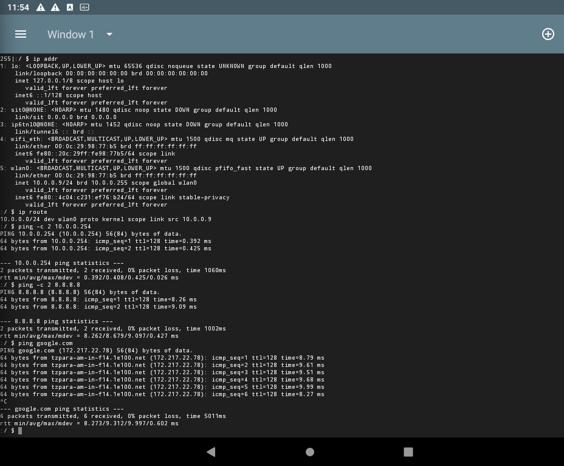
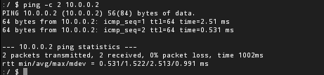
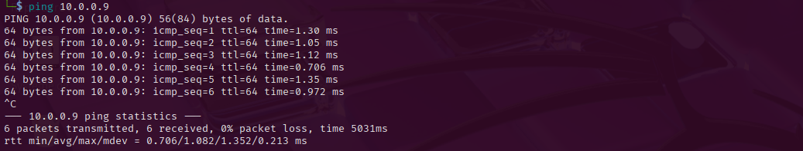

# NETWORKWALKS--BJMIKIA-B084-WK1-PM1-Android-x86-SETUP
Android-x86 setup 

🇬🇧 [English](#english) | 🇫🇷 [Français](#français)

---

## English

### Context

Extra project for week 1 : install an Android VM and give it a static IP on the same NAT network as my Kali VM (`10.0.0.0/24`). The exercise was written for VirtualBox. I used VMware Workstation instead, which changed a few details (disk type, gateway address, network interface).

### Setup

| Item | Value |
|---|---|
| Hypervisor | VMware Workstation |
| Guest OS | Android-x86 |
| Disk type | SATA |
| Network mode | NAT (VMnet8) |
| Subnet | 10.0.0.0/24 |
| Android IP | 10.0.0.9/24 |
| Gateway | 10.0.0.254 (the exercise says 10.0.0.1) |
| DNS | 8.8.8.8 |

### Screenshots

**Connectivity test from Android**



**Ping from Kali to Android (both VMs on the same NAT network)**

### Steps

1. Create the VM, attach the Android-x86 ISO, and use a **SATA** virtual disk.
2. Boot the ISO and choose **Installation**. Create a bootable `ext4` partition and install the GRUB bootloader.
3. When the install finishes, **power off** the VM (no Run or Reboot) and disconnect the ISO.
4. Boot from the disk and wait for the first start (a few minutes).
5. Go to **Settings → Network & internet → Wi-Fi**, open the connected network, and switch **IP settings** to **Static**:

| Field | Value |
|---|---|
| IP address | 10.0.0.9 |
| Gateway | 10.0.0.254 |
| Network prefix length | 24 |
| DNS 1 | 8.8.8.8 |

6. Restart the VM so the static IP is fully applied.
7. Test from Android and from Kali:

```bash
ping -c 2 10.0.0.254
ping -c 2 8.8.8.8
ping -c 2 google.com
ping -c 2 10.0.0.9   # from Kali
```

### Difficulties encountered

- **Install screen after every reboot:** the ISO was still connected, so the VM kept booting on the installer. Fix: power off, uncheck **Connect at power on** in the CD/DVD settings.
- **"No boot filename received" (PXE):** no bootable disk was found. The virtual disk was **NVMe**, which Android-x86 does not handle well. Fix: switch to **SATA** and reinstall.
- **Black screen / console prompt at boot:** a graphics issue under VMware. Booting with `nomodeset` fixed it.
- **Making `nomodeset` permanent:** the GRUB entry is edited with `e` for one boot only. To keep it, I added `nomodeset` to the first `kernel` line of `grub/menu.lst` on the Android partition (remounted read-write), using `sed`.
- **Partition "device or resource busy":** the partition was already mounted by the system. I found the mount point with `mount | grep sda1` instead of mounting it again.
- **No Ethernet option in Android settings:** Android-x86 shows the VMware network card as a virtual Wi-Fi. The static IP is set from the Wi-Fi network settings.
- **Gateway:** the exercise uses `10.0.0.1`, but in VMware that address is the host's VMnet8 adapter. The real NAT gateway is `10.0.0.254` (moved to avoid a conflict with Kali's `.2`).
- **"Connected, no internet" message:** the static IP was only fully applied after a restart.

### What I learned

- How Android-x86 boots (GRUB legacy, `menu.lst`, kernel parameters).
- Setting a static IP on Android and testing connectivity with `ping`.
- Troubleshooting step by step: boot order, firmware, disk type, graphics.

---

## Français

### Contexte

Installer une VM Android et lui donner une IP statique sur le même réseau NAT que ma VM Kali (`10.0.0.0/24`). L'exercice était prévu pour VirtualBox. J'ai utilisé VMware Workstation, ce qui a changé quelques détails (type de disque, adresse de la passerelle, interface réseau).

### Configuration

| Élément | Valeur |
|---|---|
| Hyperviseur | VMware Workstation |
| OS invité | Android-x86 |
| Type de disque | SATA |
| Mode réseau | NAT (VMnet8) |
| Sous-réseau | 10.0.0.0/24 |
| IP d'Android | 10.0.0.9/24 |
| Passerelle | 10.0.0.254 (l'exercice indique 10.0.0.1) |
| DNS | 8.8.8.8 |

### Captures d'écran

**Test de connectivité depuis Android**


**Ping de Kali vers Android (les deux VM sont sur le même réseau NAT)**

### Étapes

1. Créer la VM, brancher l'ISO d'Android-x86 et utiliser un disque virtuel **SATA**.
2. Démarrer sur l'ISO et choisir **Installation**. Créer une partition `ext4` bootable et installer le bootloader GRUB.
3. À la fin de l'installation, **éteindre** la VM (sans Run ni Reboot) et déconnecter l'ISO.
4. Démarrer depuis le disque et attendre le premier démarrage (quelques minutes).
5. Aller dans **Settings → Network & internet → Wi-Fi**, ouvrir le réseau connecté, et passer **IP settings** sur **Static** :

| Champ | Valeur |
|---|---|
| IP address | 10.0.0.9 |
| Gateway | 10.0.0.254 |
| Network prefix length | 24 |
| DNS 1 | 8.8.8.8 |

6. Redémarrer la VM pour que l'IP statique soit bien appliquée.
7. Tester depuis Android et depuis Kali :

```bash
ping -c 2 10.0.0.254
ping -c 2 8.8.8.8
ping -c 2 google.com
ping -c 2 10.0.0.9   # depuis Kali
```

### Difficultés rencontrées

- **Retour sur l'écran d'installation à chaque reboot :** l'ISO était toujours connectée, donc la VM redémarrait sur l'installeur. Solution : éteindre, décocher **Connect at power on** dans les réglages CD/DVD.
- **« No boot filename received » (PXE) :** aucun disque bootable trouvé. Le disque virtuel était en **NVMe**, mal géré par Android-x86. Solution : passer en **SATA** et réinstaller.
- **Écran noir / invite de console au démarrage :** problème graphique sous VMware. Démarrer avec `nomodeset` l'a réglé.
- **Rendre `nomodeset` permanent :** modifier l'entrée GRUB avec `e` ne vaut que pour un démarrage. Pour le garder, j'ai ajouté `nomodeset` à la première ligne `kernel` de `grub/menu.lst` sur la partition Android (remontée en lecture-écriture), avec `sed`.
- **Partition « device or resource busy » :** la partition était déjà montée par le système. J'ai trouvé son point de montage avec `mount | grep sda1` au lieu de la remonter.
- **Pas d'option Ethernet dans les réglages Android :** Android-x86 affiche la carte réseau VMware comme un Wi-Fi virtuel. L'IP statique se règle depuis les paramètres du réseau Wi-Fi.
- **Passerelle :** l'exercice utilise `10.0.0.1`, mais sous VMware cette adresse est celle de la carte VMnet8 de l'hôte. La vraie passerelle NAT est `10.0.0.254` (déplacée pour éviter le conflit avec le `.2` de Kali).
- **Message « connecté, sans internet » :** l'IP statique n'a été complètement prise en compte qu'après un redémarrage.

### Ce que j'ai appris

- Le démarrage d'Android-x86 (GRUB legacy, `menu.lst`, paramètres du noyau).
- La configuration d'une IP statique sur Android et le test de connectivité avec `ping`.
- Un dépannage méthodique : ordre de boot, firmware, type de disque, affichage.
